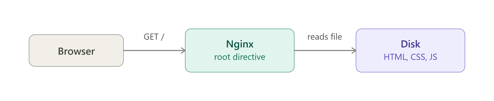

# Q: How do you host a static website with Nginx?

> **Level:** Basic (Fresher) · **Asked in:** DevOps, Frontend, Full-stack, Cloud

## 🎯 Short answer (say this in the interview)

I copy the site files (HTML, CSS, JS, images - or a React/Vue `build`/`dist` folder) to a directory like `/var/www/mysite`, make sure the Nginx user (`www-data` on Ubuntu) can read them, and create a **server block** in `/etc/nginx/sites-available/mysite` with `listen 80`, `server_name`, `root /var/www/mysite`, `index index.html` and `location / { try_files $uri $uri/ =404; }`. Then I enable it with a symlink into `sites-enabled`, run `sudo nginx -t`, reload, and test with `curl`. For a single-page app I change the fallback to `try_files $uri $uri/ /index.html;` so client-side routes work.

## 🧩 Scenario

Marketing gives you a zipped landing page (`index.html`, `about.html`, `css/`, `img/`) and a domain `mysite.com` already pointing to your Ubuntu 24.04 server's IP. They want it live today, fast, with browser caching for images and a nice 404 page.



## 💼 Use case

- Company landing pages, docs sites, portfolios, status pages.
- React / Angular / Vue production builds (single-page apps).
- Static site generators output (Hugo, Jekyll, Docusaurus, MkDocs).
- Serving downloads, images and other assets next to an API.

## ⚙️ How it works

```text
Browser: GET http://mysite.com/about.html
   |
   v
Nginx :80
   | 1. listen 80 + Host "mysite.com"  -> server block in sites-enabled/mysite
   | 2. location / matches
   | 3. try_files $uri $uri/ =404
   |       $uri = /about.html  -> file path = root + uri
   |                            = /var/www/mysite/about.html
   |       exists?  yes -> send it (Content-Type from mime.types: text/html)
   |                no  -> try /var/www/mysite/about.html/ (a directory with index)
   |                no  -> return 404 (our custom /404.html page)
   v
Response 200 + file (sent efficiently with sendfile)

Request "/"  -> directory -> "index" directive -> /var/www/mysite/index.html
```

`root` builds the path as **root + full URI**. The Nginx worker (user `www-data`) needs **read** permission on files and **execute (x)** permission on every directory in the path.

## 🛠️ Practical: step by step

### 1. Install Nginx (if not done)

```bash
sudo apt update && sudo apt install -y nginx
sudo ufw allow 'Nginx HTTP'     # or 'Nginx Full' for 80 + 443
```

### 2. Create the site directory and files

```bash
sudo mkdir -p /var/www/mysite/css /var/www/mysite/img

sudo tee /var/www/mysite/index.html >/dev/null <<'EOF'
<!doctype html>
<html>
<head>
  <meta charset="utf-8">
  <title>My Site</title>
  <link rel="stylesheet" href="/css/style.css">
</head>
<body>
  <h1>Hello from Nginx!</h1>
  <a href="/about.html">About</a>
</body>
</html>
EOF

echo '<h1>About us</h1>'           | sudo tee /var/www/mysite/about.html >/dev/null
echo 'body { font-family: sans-serif; }' | sudo tee /var/www/mysite/css/style.css >/dev/null
echo '<h1>404 - Page not found</h1>' | sudo tee /var/www/mysite/404.html >/dev/null
```

(For a real site, upload files with `scp -r ./dist/* user@server:/tmp/site/` and then `sudo cp -r /tmp/site/* /var/www/mysite/`, or use `rsync`.)

### 3. Set ownership and permissions

Nginx only needs to **read** the files. A clean setup: your deploy user owns the files, group is `www-data`, directories `755`, files `644`.

```bash
sudo chown -R $USER:www-data /var/www/mysite
sudo find /var/www/mysite -type d -exec chmod 755 {} \;
sudo find /var/www/mysite -type f -exec chmod 644 {} \;

# check every directory in the path is reachable by www-data
namei -l /var/www/mysite/index.html
```

> Many tutorials use `sudo chown -R www-data:www-data /var/www/mysite`. It works, but it also gives the web server **write** access to your site, which is not needed for a static site. Read-only for Nginx is safer.

### 4. Create the server block

Create `/etc/nginx/sites-available/mysite`:

```nginx
# /etc/nginx/sites-available/mysite
server {
    listen 80;                          # IPv4
    listen [::]:80;                     # IPv6
    server_name mysite.com www.mysite.com;

    root /var/www/mysite;               # where the files are
    index index.html;                   # file to serve for "/" and directories

    # separate logs for this site
    access_log /var/log/nginx/mysite.access.log;
    error_log  /var/log/nginx/mysite.error.log;

    # main rule: serve the file, or the directory index, or 404
    location / {
        try_files $uri $uri/ =404;
        # For a React/Vue single-page app use instead:
        # try_files $uri $uri/ /index.html;
    }

    # cache static assets in the browser for 7 days
    location ~* \.(css|js|png|jpg|jpeg|gif|svg|ico|webp|woff2?)$ {
        expires 7d;                     # adds Expires + Cache-Control: max-age=604800
        access_log off;                 # do not log every image request
    }

    # custom 404 page
    error_page 404 /404.html;
    location = /404.html {
        internal;                       # cannot be requested directly, only used by error_page
    }

    # never serve hidden files like .git or .env
    # (but allow /.well-known/, which Let's Encrypt uses)
    location ~ /\.(?!well-known) {
        deny all;
    }
}
```

### 5. Enable the site, test, reload

```bash
sudo ln -s /etc/nginx/sites-available/mysite /etc/nginx/sites-enabled/mysite

# optional: disable Ubuntu's welcome site
sudo rm /etc/nginx/sites-enabled/default

sudo nginx -t
sudo systemctl reload nginx
```

### 6. Test (before DNS works, send the Host header yourself)

```bash
curl -H "Host: mysite.com" http://127.0.0.1/
# or add "127.0.0.1 mysite.com" to /etc/hosts on your machine (pointing to the server IP)
```

### 7. (Optional) Add HTTPS

```bash
sudo apt install -y certbot python3-certbot-nginx
sudo certbot --nginx -d mysite.com -d www.mysite.com
```

## 📁 Files involved

| File / Folder | What it does here |
|---|---|
| `/var/www/mysite/` | Document root with the site files |
| `/etc/nginx/sites-available/mysite` | Server block for the site |
| `/etc/nginx/sites-enabled/mysite` | Symlink that enables it |
| `/etc/nginx/sites-enabled/default` | Ubuntu welcome site (removed in step 5, optional) |
| `/etc/nginx/mime.types` | Gives each file the right `Content-Type` |
| `/var/log/nginx/mysite.access.log`, `mysite.error.log` | Per-site logs |

## ✅ Verify it works

```bash
sudo nginx -t
# nginx: the configuration file /etc/nginx/nginx.conf syntax is ok
# nginx: configuration file /etc/nginx/nginx.conf test is successful

sudo systemctl reload nginx

curl -I -H "Host: mysite.com" http://127.0.0.1/
# HTTP/1.1 200 OK
# Server: nginx/1.xx.x (Ubuntu)
# Content-Type: text/html

curl -I -H "Host: mysite.com" http://127.0.0.1/css/style.css
# HTTP/1.1 200 OK
# Content-Type: text/css
# Expires: ...
# Cache-Control: max-age=604800

curl -s -o /dev/null -w "%{http_code}\n" -H "Host: mysite.com" http://127.0.0.1/nope.html
# 404       (body is your custom 404.html)

curl -s -o /dev/null -w "%{http_code}\n" -H "Host: mysite.com" http://127.0.0.1/.env
# 403       (hidden files are blocked)

sudo tail -n 3 /var/log/nginx/mysite.access.log
```

## ⚠️ Common mistakes

- **403 Forbidden** - permissions: Nginx cannot read the file or cannot enter a parent directory (e.g. files in `/home/user/site` where `/home/user` is `750`). Check `namei -l` and the error log (`Permission denied`).
- **403 on `/`** - no `index.html` in the root and `autoindex` is off (`directory index of ... is forbidden`).
- **Still seeing the welcome page** - the symlink is missing, `server_name` does not match the Host you used, or the `default` site is catching the request.
- Using `root` inside `location /images/` with `/var/www/mysite/images` → Nginx looks in `/var/www/mysite/images/images/...`. Use `root /var/www/mysite;` or `alias`.
- React app routes like `/dashboard` return 404 on refresh → use `try_files $uri $uri/ /index.html;`.
- CSS downloads as a file or is ignored → `include mime.types` missing in a custom `nginx.conf`.

## 🔁 Follow-up questions interviewers ask

- **What is the difference between `root` and `alias`?** `root` appends the full URI to the path; `alias` replaces the matched location prefix with the path.
- **What does `try_files` do?** Checks the listed files/dirs in order and serves the first that exists; the last parameter is a fallback URI or `=code`.
- **How do you enable directory listing?** `autoindex on;` in the location (avoid on public sites).
- **How do you speed up a static site?** `gzip on` with `gzip_types`, browser caching with `expires`, `sendfile on`, HTTP/2 with HTTPS, and a CDN in front.
- **How do you host two static sites on one server?** Two server blocks with different `server_name` and `root` (name-based virtual hosting).

---
[⬅️ Previous](09-nginx-commands-start-stop-reload.md) · [🏠 Index](../README.md) · [Next ➡️](11-server-block-listen-server-name.md)
