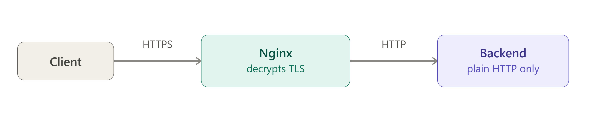

# Q: How do you enable HTTPS on Nginx? Walk me through it with Let's Encrypt.

> **Level:** Intermediate · **Asked in:** DevOps, SRE, Backend, Full-stack, Cloud Engineer

## 🎯 Short answer (say this in the interview)

I point the domain's DNS to the server, open ports 80 and 443, and use **certbot with the Nginx plugin** (`sudo certbot --nginx -d example.com -d www.example.com`). Certbot proves domain ownership with an HTTP challenge, gets a free Let's Encrypt certificate, stores it in `/etc/letsencrypt/live/<domain>/`, and edits my server block to add `listen 443 ssl`, `ssl_certificate` and `ssl_certificate_key`. Renewal is automatic through a systemd timer, and I test it with `sudo certbot renew --dry-run`. Then I harden it: redirect HTTP→HTTPS with `return 301`, allow only `TLSv1.2 TLSv1.3`, enable HTTP/2, and add an HSTS header. Nginx does the **SSL termination**, so my backend can keep speaking plain HTTP on localhost.

## 🧩 Scenario

You deployed `app.example.com` on an Ubuntu VM. Chrome shows **"Not secure"**, login forms send passwords in clear text, and the product team wants HTTP/2. You need valid HTTPS today, with automatic renewal so the certificate never expires at 3 a.m.



## 💼 Use case

- Any public website or API (browsers mark HTTP pages as "Not secure").
- SSL termination in front of Node.js / Python / Java apps — backends stay simple.
- Required for HTTP/2 in browsers, secure cookies, service workers, and many browser APIs.
- Compliance (PCI-DSS, etc.) requires encryption in transit.

## ⚙️ How it works

```text
                 HTTPS (encrypted, port 443)          HTTP (plain, localhost)
  Browser  ==================================>  Nginx  ------------------------>  App :3000
           <==================================         <------------------------
                TLS handshake: Nginx presents
                fullchain.pem, proves it owns
                privkey.pem

  Browser  ---- HTTP (port 80) ---->  Nginx  -- 301 --> https://app.example.com/...

  Getting the cert (HTTP-01 challenge):
  certbot --nginx
     | 1. asks Let's Encrypt for a cert for app.example.com
     | 2. LE says: "serve token X at http://app.example.com/.well-known/acme-challenge/X"
     | 3. certbot temporarily configures Nginx to serve it
     | 4. LE fetches it over port 80 -> domain ownership proven
     v 5. cert saved in /etc/letsencrypt/live/app.example.com/ and Nginx config updated
```

Files certbot creates in `/etc/letsencrypt/live/<domain>/` (symlinks to the latest version in `../archive/`):

| File | Contents | Use in Nginx |
|---|---|---|
| `fullchain.pem` | Your cert + intermediate chain | `ssl_certificate` |
| `privkey.pem` | Private key (keep secret) | `ssl_certificate_key` |
| `cert.pem` | Your cert only | Usually not used directly |
| `chain.pem` | Intermediate chain only | `ssl_trusted_certificate` (if needed) |

Let's Encrypt certificates are short-lived (currently 90 days; Let's Encrypt has announced plans to shorten lifetimes further), which is why **automatic renewal** is essential.

## 🛠️ Practical: step by step

### Prerequisites

- DNS `A` record (and `AAAA` for IPv6, if used) for `app.example.com` (and `www`) pointing to the server's public IP. Check with `dig +short app.example.com`.
- Port 80 and 443 open in the cloud security group **and** on the server firewall.
- A working HTTP server block with the correct `server_name`.

### 1. Install Nginx and open the firewall

```bash
sudo apt update
sudo apt install -y nginx
sudo ufw allow 'Nginx Full'     # opens 80 and 443
sudo ufw allow OpenSSH          # don't lock yourself out
sudo ufw enable
```

### 2. Create a plain HTTP server block first

```bash
sudo mkdir -p /var/www/app.example.com
echo '<h1>Hello HTTPS</h1>' | sudo tee /var/www/app.example.com/index.html
sudo nano /etc/nginx/sites-available/app.example.com
```

```nginx
# File: /etc/nginx/sites-available/app.example.com  (before certbot)
server {
    listen 80;
    listen [::]:80;
    server_name app.example.com www.app.example.com;

    root /var/www/app.example.com;
    index index.html;
}
```

```bash
sudo ln -s /etc/nginx/sites-available/app.example.com /etc/nginx/sites-enabled/
sudo nginx -t && sudo systemctl reload nginx
```

### 3. Install certbot (pick ONE option)

**Option A — snap (recommended by the certbot project):**

```bash
sudo apt remove -y certbot            # remove any old apt version first
sudo snap install --classic certbot
sudo ln -s /snap/bin/certbot /usr/bin/certbot
```

**Option B — apt (Ubuntu package, simpler, may be an older version):**

```bash
sudo apt install -y certbot python3-certbot-nginx
```

### 4. Get the certificate and let certbot edit Nginx

```bash
sudo certbot --nginx -d app.example.com -d www.app.example.com
# Enter email, agree to terms, and certbot installs the cert.
# Recent certbot versions configure the HTTP->HTTPS redirect automatically.
```

### 5. Check renewal

```bash
sudo certbot renew --dry-run          # simulates renewal, must say "succeeded"
systemctl list-timers | grep -i certbot
# snap install -> snap.certbot.renew.timer
# apt install  -> certbot.timer
sudo certbot certificates             # lists certs, domains and expiry dates
```

Certbot's Nginx installer reloads Nginx after a successful renewal, so the new cert is picked up automatically.

### 6. Harden the final config

After certbot runs, clean up the file so it looks like this:

```nginx
# File: /etc/nginx/sites-available/app.example.com  (final)

# --- 1. Redirect all HTTP to HTTPS ---
server {
    listen 80;
    listen [::]:80;
    server_name app.example.com www.app.example.com;

    return 301 https://app.example.com$request_uri;
}

# --- 2. HTTPS server ---
server {
    # Nginx 1.25.1 and newer: HTTP/2 is a separate directive
    listen 443 ssl;
    listen [::]:443 ssl;
    http2 on;

    # Nginx older than 1.25.1 (Ubuntu 22.04 apt = 1.18, Ubuntu 24.04 apt = 1.24):
    # "http2 on;" does not exist there - use the old (now deprecated) form instead:
    # listen 443 ssl http2;
    # listen [::]:443 ssl http2;

    server_name app.example.com www.app.example.com;

    # Certificate files written by certbot
    ssl_certificate     /etc/letsencrypt/live/app.example.com/fullchain.pem;
    ssl_certificate_key /etc/letsencrypt/live/app.example.com/privkey.pem;

    # Certbot's recommended TLS settings (ciphers, session cache) + DH params
    include /etc/letsencrypt/options-ssl-nginx.conf;
    ssl_dhparam /etc/letsencrypt/ssl-dhparams.pem;

    # Modern protocols only (TLS 1.0/1.1 are deprecated).
    # Note: options-ssl-nginx.conf also sets ssl_protocols; if "nginx -t"
    # reports a duplicate, set it in one place only.
    # ssl_protocols TLSv1.2 TLSv1.3;

    # HSTS: browsers will use HTTPS only for this domain for 1 year.
    # Start with a small max-age while testing; add "preload" only when sure.
    add_header Strict-Transport-Security "max-age=31536000; includeSubDomains" always;

    root /var/www/app.example.com;
    index index.html;

    # Example: SSL termination in front of a Node.js app
    # location /api/ {
    #     proxy_pass http://127.0.0.1:3000;
    #     proxy_set_header Host $host;
    #     proxy_set_header X-Forwarded-Proto $scheme;   # app knows it was HTTPS
    #     proxy_set_header X-Forwarded-For $proxy_add_x_forwarded_for;
    # }
}
```

If you write TLS settings yourself (without certbot's include file), a solid baseline is:

```nginx
ssl_protocols TLSv1.2 TLSv1.3;
ssl_prefer_server_ciphers off;
ssl_session_cache shared:SSL:10m;
ssl_session_timeout 1d;
ssl_session_tickets off;
```

```bash
nginx -v                                  # check version to choose http2 syntax
sudo nginx -t && sudo systemctl reload nginx
```

### 7. Local testing: self-signed certificate with openssl

Let's Encrypt cannot issue certs for `localhost` or private IPs. For local labs, create a self-signed cert (browsers will warn — that is expected):

```bash
sudo openssl req -x509 -nodes -days 365 -newkey rsa:2048 \
  -keyout /etc/ssl/private/nginx-selfsigned.key \
  -out /etc/ssl/certs/nginx-selfsigned.crt \
  -subj "/CN=localhost" \
  -addext "subjectAltName=DNS:localhost,IP:127.0.0.1"
```

```nginx
# File: /etc/nginx/sites-available/local-https
server {
    listen 443 ssl;
    server_name localhost;

    ssl_certificate     /etc/ssl/certs/nginx-selfsigned.crt;
    ssl_certificate_key /etc/ssl/private/nginx-selfsigned.key;
    ssl_protocols TLSv1.2 TLSv1.3;

    root /var/www/html;
}
```

```bash
sudo ln -s /etc/nginx/sites-available/local-https /etc/nginx/sites-enabled/
sudo nginx -t && sudo systemctl reload nginx
curl -k https://localhost/      # -k = accept the self-signed cert
```

## 📁 Files involved

| File / Folder | What it does here |
|---|---|
| `/etc/nginx/sites-available/app.example.com` | Server blocks for HTTP redirect and HTTPS |
| `/etc/nginx/sites-enabled/app.example.com` | Symlink that activates the site |
| `/etc/letsencrypt/live/app.example.com/` | Symlinks to the current `fullchain.pem`, `privkey.pem` |
| `/etc/letsencrypt/archive/` | Real certificate files (all versions) |
| `/etc/letsencrypt/renewal/app.example.com.conf` | How certbot renews this cert (authenticator, installer) |
| `/etc/letsencrypt/options-ssl-nginx.conf` | Certbot's TLS settings included by the server block |
| `/etc/letsencrypt/ssl-dhparams.pem` | DH parameters used by `ssl_dhparam` |
| `/var/log/letsencrypt/letsencrypt.log` | Certbot logs (check when issuance/renewal fails) |
| `/etc/ssl/certs/`, `/etc/ssl/private/` | Self-signed cert and key for local testing |

## ✅ Verify it works

```bash
sudo nginx -t
sudo systemctl reload nginx

curl -I http://app.example.com/
# HTTP/1.1 301 Moved Permanently
# Location: https://app.example.com/

curl -I https://app.example.com/
# HTTP/2 200
# strict-transport-security: max-age=31536000; includeSubDomains

# Check which certificate is served and its expiry dates
echo | openssl s_client -connect app.example.com:443 -servername app.example.com 2>/dev/null \
  | openssl x509 -noout -subject -issuer -dates

# TLS 1.1 must be refused, TLS 1.2 accepted
openssl s_client -connect app.example.com:443 -servername app.example.com -tls1_1 </dev/null   # handshake failure
openssl s_client -connect app.example.com:443 -servername app.example.com -tls1_2 </dev/null   # Verify return code: 0 (ok)

sudo certbot renew --dry-run
# Congratulations, all simulated renewals succeeded
```

## ⚠️ Common mistakes

- DNS not pointing to the server yet, or port 80 blocked in the cloud security group → the HTTP-01 challenge fails.
- Redirecting `/.well-known/acme-challenge/` to somewhere else or blocking it → renewals fail later. (A plain `return 301` to HTTPS is fine; Let's Encrypt follows redirects.)
- Using `cert.pem` instead of `fullchain.pem` → some clients (curl, Android, APIs) fail with "unable to get local issuer certificate".
- Writing `http2 on;` on Ubuntu's default Nginx (1.18 / 1.24) → `unknown directive "http2"`. Check `nginx -v`.
- Adding HSTS with `preload` and a long `max-age` before all subdomains support HTTPS → those subdomains become unreachable in browsers.
- `add_header` for HSTS in the `server` block, then another `add_header` in a `location` → the HSTS header disappears there (add_header is not inherited when a level defines its own).
- Forgetting `-servername` in `openssl s_client` → you may see the default server's certificate, not yours.
- Copying private keys around with loose permissions; `privkey.pem` should be readable by root only.

## 🔁 Follow-up questions interviewers ask

- **What is SSL termination?** Nginx decrypts HTTPS and talks plain HTTP to the backend on a private network/localhost, so apps don't each need certificates. Pass `X-Forwarded-Proto` so the app knows the original scheme.
- **How does certbot renew automatically?** A systemd timer (`snap.certbot.renew.timer` or `certbot.timer`) runs `certbot renew` twice a day; it only renews certs close to expiry and reloads Nginx afterwards.
- **HTTP-01 vs DNS-01 challenge?** HTTP-01 needs port 80 reachable; DNS-01 proves ownership via a DNS TXT record, works for internal servers and is required for wildcard certs (`*.example.com`).
- **What does HSTS do?** It tells browsers to always use HTTPS for the domain for `max-age` seconds, preventing SSL-stripping downgrade attacks.
- **Why 301 and not 302 for HTTP→HTTPS?** The move is permanent; 301 is cached by browsers and passes SEO signals. Use `308` if you must preserve the method of non-GET requests.

---
[⬅️ Previous](03-load-balancing-methods.md) · [🏠 Index](../README.md) · [Next ➡️](05-try-files-react-spa-routing.md)
