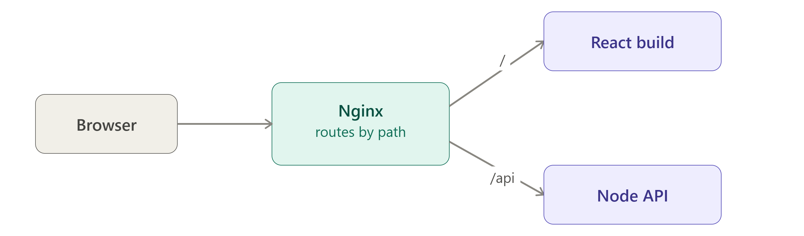

# Q: What is `try_files`, and why does a React/Vue single-page app need it?

> **Level:** Intermediate · **Asked in:** Full-stack, Frontend, DevOps, MERN developer

## 🎯 Short answer (say this in the interview)

`try_files` tells Nginx to check a list of files in order and serve the first one that exists; the last argument is the fallback (a URI or a status code like `=404`). A React/Vue SPA has only **one real HTML file**, `index.html`; routes like `/dashboard` exist only in JavaScript (React Router / Vue Router). When the user refreshes on `/dashboard`, the browser asks Nginx for a file called `/dashboard`, which doesn't exist, so Nginx returns **404**. With `try_files $uri $uri/ /index.html;` Nginx serves the real file if it exists, otherwise returns `index.html` and the client-side router shows the right page. I also cache hashed assets for a year and mark `index.html` as `no-cache` so new deployments show up immediately.

## 🧩 Scenario

You deployed a React app (built with Vite) to `/var/www/myapp`. The home page works. You click to `/products/42` — it works. You press **F5** or share the link with a friend — they see Nginx's **"404 Not Found"** page. Then, after a new deployment, some users still see the old version for hours.



## 💼 Use case

- Hosting any SPA: React (Vite/CRA), Vue, Angular, Svelte.
- Same pattern for PHP front controllers: `try_files $uri $uri/ /index.php?$query_string;`.
- Serving static files first, then falling back to an app server: `try_files $uri @backend;`.
- Returning a clean 404 for missing assets: `try_files $uri =404;`.

## ⚙️ How it works

Syntax: `try_files file1 file2 ... fallback;` (valid in `server` and `location`).

- `$uri` → check a file at `root + $uri`.
- `$uri/` → check a directory (then the `index` directive applies).
- Last argument → **internal redirect** to that URI (or `=code` to return a status, or `@name` for a named location). The last argument is never checked as a file.

```text
WITHOUT try_files                          WITH try_files $uri $uri/ /index.html

Browser: GET /products/42                  Browser: GET /products/42
   |                                          |
   v                                          v
Nginx looks for                            Nginx tries:
/var/www/myapp/products/42                   1. /var/www/myapp/products/42   -> no
   |                                          2. /var/www/myapp/products/42/  -> no
   v                                          3. fallback: internal redirect to /index.html
404 Not Found  :(                             |
                                              v
                                           200 index.html -> React loads,
                                           React Router reads /products/42
                                           and renders the product page  :)

Real asset:   GET /assets/index-a1b2c3.js  -> step 1 finds the file -> served directly
```

### Caching: hashed assets vs index.html

Build tools put a content hash in asset filenames (`index-a1b2c3.js`). When the code changes, the filename changes. So:

```text
index.html            -> "no-cache"  (browser must re-check every time, gets new file names)
   |
   +-- <script src="/assets/index-a1b2c3.js">   -> cache 1 year, immutable
   +-- <link  href="/assets/index-9f8e7d.css">  -> cache 1 year, immutable
```

If you cache `index.html` for a long time, users keep loading **old** HTML pointing at **old** JS — the "my deploy didn't show up" problem.

## 🛠️ Practical: step by step

1. Build the app and copy the output to the server folder.

```bash
# On your machine or CI (Vite outputs to dist/, Create React App to build/)
npm ci
npm run build

# On the server
sudo mkdir -p /var/www/myapp
sudo rsync -a --delete dist/ /var/www/myapp/
sudo chown -R www-data:www-data /var/www/myapp
```

2. Create the server block.

```bash
sudo nano /etc/nginx/sites-available/myapp
```

```nginx
# File: /etc/nginx/sites-available/myapp
server {
    listen 80;
    server_name myapp.example.com;

    root /var/www/myapp;
    index index.html;

    # 1) SPA routing: real file -> real directory -> fall back to index.html
    location / {
        try_files $uri $uri/ /index.html;
    }

    # 2) index.html must always be revalidated so new deployments show up.
    #    The fallback above internally redirects to /index.html,
    #    so this block applies to SPA routes too.
    location = /index.html {
        add_header Cache-Control "no-cache" always;
    }

    # 3) Hashed build assets: cache for 1 year.
    #    Vite puts them in /assets/, Create React App in /static/.
    #    =404 so a missing JS file returns 404, not index.html (HTML served as JS
    #    causes confusing "Unexpected token '<'" errors).
    location /assets/ {
        try_files $uri =404;
        add_header Cache-Control "public, max-age=31536000, immutable" always;
        access_log off;
    }

    # 4) Optional: API calls go to the backend, never to index.html
    location /api/ {
        proxy_pass http://127.0.0.1:5000;
        proxy_set_header Host $host;
        proxy_set_header X-Real-IP $remote_addr;
        proxy_set_header X-Forwarded-For $proxy_add_x_forwarded_for;
        proxy_set_header X-Forwarded-Proto $scheme;
    }
}
```

3. Enable and reload.

```bash
sudo ln -s /etc/nginx/sites-available/myapp /etc/nginx/sites-enabled/
sudo nginx -t && sudo systemctl reload nginx
```

### SPA under a sub-path (e.g. `/app/`)

```nginx
# Build the app with base "/app/" (Vite: base: '/app/'; CRA: "homepage" in package.json)
location /app/ {
    alias /var/www/myapp/;
    try_files $uri $uri/ /app/index.html;
}
```

The fallback is a **URI**, so it must include the `/app/` prefix.

## 📁 Files involved

| File / Folder | What it does here |
|---|---|
| `/etc/nginx/sites-available/myapp` | Server block with `try_files` and cache rules |
| `/etc/nginx/sites-enabled/myapp` | Symlink that activates it |
| `/var/www/myapp/index.html` | The single HTML entry point of the SPA |
| `/var/www/myapp/assets/` | Hashed JS/CSS from the Vite build (`static/` for CRA) |
| `/var/log/nginx/error.log` | Shows `rewrite or internal redirection cycle` if the fallback itself is missing |

## ✅ Verify it works

```bash
# Deep link must return 200 and HTML (not 404)
curl -sI -H 'Host: myapp.example.com' http://127.0.0.1/products/42
# HTTP/1.1 200 OK
# Content-Type: text/html
# Cache-Control: no-cache

# Hashed asset: long cache (use a real filename from /var/www/myapp/assets/)
ls /var/www/myapp/assets/ | head -3
curl -sI -H 'Host: myapp.example.com' http://127.0.0.1/assets/index-XXXX.js
# HTTP/1.1 200 OK
# Content-Type: application/javascript   (newer mime.types may say text/javascript)
# Cache-Control: public, max-age=31536000, immutable

# Missing asset must be a real 404
curl -s -o /dev/null -w '%{http_code}\n' -H 'Host: myapp.example.com' http://127.0.0.1/assets/nope.js
# 404
```

In the browser: open DevTools → Network, refresh on a deep route — the document request should be `200`, and JS/CSS should show `(memory cache)` or `(disk cache)` on repeat visits.

## ⚠️ Common mistakes

- Forgetting `try_files` → 404 on refresh or on shared deep links.
- Writing `try_files $uri $uri/ index.html;` (no leading `/`) → the fallback is an internal redirect to a URI, so it must be `/index.html`.
- Falling back to `/index.html` for **everything**, including `/api/` and `/assets/` → API 404s and missing JS files come back as HTML with status 200.
- Caching `index.html` for a long time → users stuck on old versions after deploy.
- Adding `expires 1y;` **and** `add_header Cache-Control ...` in the same block → two `Cache-Control` headers. Pick one approach.
- Using `try_files $uri /index.html =404;` and expecting `/index.html` to be the fallback — only the **last** argument is the fallback; earlier ones are checked as files.
- If `/index.html` itself is missing, Nginx logs `rewrite or internal redirection cycle` and returns 500.

## 🔁 Follow-up questions interviewers ask

- **Why not just use a custom 404 page that loads index.html (`error_page 404 /index.html`)?** It works visually but returns status 404 for valid routes — bad for SEO and monitoring. `try_files` returns 200.
- **What is the difference between `$uri` and `$uri/` in try_files?** `$uri` checks a file; `$uri/` checks a directory and then serves its `index` file.
- **Does try_files change the URL in the browser?** No. It's an internal redirect; the browser still shows `/products/42`.
- **How would you serve static files and fall back to a Node app?** `try_files $uri $uri/ @node;` plus `location @node { proxy_pass http://127.0.0.1:3000; }`.
- **How do you make sure users get the new version after deploy?** Hashed filenames + long cache for assets, `no-cache` for `index.html`. Safest: build into a new release folder (e.g. `/var/www/releases/<timestamp>`) and switch a symlink that `root` points to, keeping the previous release's assets around for users who still have the old `index.html` open.

---
[⬅️ Previous](04-https-ssl-certbot-setup.md) · [🏠 Index](../README.md) · [Next ➡️](06-proxy-headers-real-client-ip.md)
