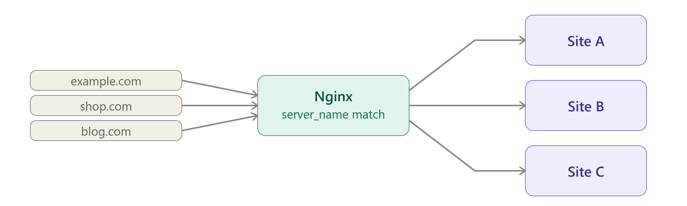

# Q: How do you host multiple websites on a single Nginx server?

> **Level:** Intermediate · **Asked in:** DevOps, Linux Admin, Full-stack, Freelance/Agency developers

## 🎯 Short answer (say this in the interview)

I use **name-based virtual hosts**: one `server` block per site, all listening on the same port 80/443, each with its own `server_name`. Nginx reads the `Host` header of each request (or the SNI name for HTTPS) and picks the matching server block. On Ubuntu I create each site in `/etc/nginx/sites-available/` and enable it with a symlink in `/etc/nginx/sites-enabled/`, then run `nginx -t` and reload. Each domain's DNS `A` record points to the same server IP. I also add a `default_server` catch-all that returns `444` so requests for unknown hosts or raw IP scans don't land on a real site.

## 🧩 Scenario

You have one $10/month VM with one public IP. You need to host:

- `blog.example.com` — a static site (HTML/CSS).
- `app.example.com` — a Node.js app running on port 3000.

Bots that hit the server by its raw IP should get nothing, not your blog.



## 💼 Use case

- Agencies hosting many client sites on one server.
- Staging and production of the same app on one box (`staging.app.com`, `app.com`).
- Marketing site + app + docs + API subdomains on one Nginx.
- Shared "edge" Nginx routing domains to different internal services.

## ⚙️ How it works

```text
DNS:  blog.example.com  A  203.0.113.10  ----+
      app.example.com   A  203.0.113.10  ----+---->  ONE server, ONE IP, port 80/443
      (raw IP / unknown) ------------------------+
                                                 |
                                                 v
                                   +---------------------------+
                                   | Nginx reads Host header   |
                                   | (SNI for HTTPS)           |
                                   +-------------+-------------+
             Host: blog.example.com              |  Host: app.example.com
          +--------------------------------------+---------------------------+
          |                                      |                           |
          v                                      v                           v
 server_name blog.example.com     server_name app.example.com    default_server
 root /var/www/blog               proxy_pass 127.0.0.1:3000      server_name _
 (static files)                   (Node.js app)                  return 444 (drop)
```

How Nginx chooses a server block:

1. First by `listen` (IP:port) — only server blocks listening on that address/port are candidates.
2. Then by `server_name`, in this priority: **exact name** → **longest wildcard starting with `*`** (`*.example.com`) → **longest wildcard ending with `*`** (`mail.*`) → **first matching regex** (`~^api\d+\.example\.com$`).
3. If nothing matches → the `default_server` for that `listen` (or the **first** server block defined for that port if none is marked).

## 🛠️ Practical: step by step

### 1. DNS

In your DNS provider, create two `A` records pointing to the server's public IP:

| Type | Name | Value |
|---|---|---|
| A | `blog` | `203.0.113.10` |
| A | `app` | `203.0.113.10` |

```bash
dig +short blog.example.com
dig +short app.example.com
# both should print 203.0.113.10
```

### 2. Site 1: static blog

```bash
sudo mkdir -p /var/www/blog
echo '<h1>My Blog</h1>' | sudo tee /var/www/blog/index.html
sudo chown -R www-data:www-data /var/www/blog
sudo nano /etc/nginx/sites-available/blog.example.com
```

```nginx
# File: /etc/nginx/sites-available/blog.example.com
server {
    listen 80;
    listen [::]:80;
    server_name blog.example.com;

    root /var/www/blog;
    index index.html;

    # Per-site logs make debugging much easier
    access_log /var/log/nginx/blog.access.log;
    error_log  /var/log/nginx/blog.error.log;

    location / {
        try_files $uri $uri/ =404;
    }
}
```

### 3. Site 2: Node.js app (reverse proxy)

```bash
sudo nano /etc/nginx/sites-available/app.example.com
```

```nginx
# File: /etc/nginx/sites-available/app.example.com
server {
    listen 80;
    listen [::]:80;
    server_name app.example.com;

    access_log /var/log/nginx/app.access.log;
    error_log  /var/log/nginx/app.error.log;

    location / {
        proxy_pass http://127.0.0.1:3000;     # Node app listens only on localhost
        include proxy_params;                 # Host, X-Real-IP, X-Forwarded-For, X-Forwarded-Proto

        # WebSocket support (if the app uses socket.io etc.)
        proxy_http_version 1.1;
        proxy_set_header Upgrade $http_upgrade;
        proxy_set_header Connection "upgrade";
    }
}
```

> If you don't need WebSockets, remove the last three lines (a fixed `Connection "upgrade"` on every request is harmless for most apps, but the cleaner pattern uses a `map` on `$http_upgrade`).

### 4. Catch-all default server

```bash
sudo nano /etc/nginx/sites-available/00-default-catchall
```

```nginx
# File: /etc/nginx/sites-available/00-default-catchall
# Handles requests whose Host matches no site (raw IP, random domains, scanners).
server {
    listen 80 default_server;
    listen [::]:80 default_server;
    server_name _;            # "_" is just an invalid name that never matches

    return 444;               # Nginx-specific: close the connection without a response
}
```

For HTTPS on port 443, a catch-all needs either a certificate (a self-signed one is fine) or, on Nginx **1.19.4+**, `ssl_reject_handshake on;` (Ubuntu 24.04's Nginx 1.24 supports it; Ubuntu 22.04's 1.18 does not):

```nginx
server {
    listen 443 ssl default_server;
    listen [::]:443 ssl default_server;
    server_name _;
    ssl_reject_handshake on;  # refuse TLS for unknown SNI names (1.19.4+)
}
```

### 5. Enable sites, disable the Ubuntu default site

Ubuntu's `/etc/nginx/sites-enabled/default` already has `listen 80 default_server;`. Two default servers on the same port is an error, so remove that symlink (the file in `sites-available` stays as a reference).

```bash
sudo rm /etc/nginx/sites-enabled/default

sudo ln -s /etc/nginx/sites-available/blog.example.com   /etc/nginx/sites-enabled/
sudo ln -s /etc/nginx/sites-available/app.example.com    /etc/nginx/sites-enabled/
sudo ln -s /etc/nginx/sites-available/00-default-catchall /etc/nginx/sites-enabled/

ls -l /etc/nginx/sites-enabled/
sudo nginx -t && sudo systemctl reload nginx
```

To **disable** a site later: `sudo rm /etc/nginx/sites-enabled/<name> && sudo systemctl reload nginx`.

### 6. Add HTTPS for both sites at once

```bash
sudo certbot --nginx -d blog.example.com -d app.example.com
# or one certificate per site:
# sudo certbot --nginx -d blog.example.com
# sudo certbot --nginx -d app.example.com
```

Thanks to **SNI** (Server Name Indication), each HTTPS site can have its own certificate on the same IP and port.

## 📁 Files involved

| File / Folder | What it does here |
|---|---|
| `/etc/nginx/sites-available/blog.example.com` | Static blog server block |
| `/etc/nginx/sites-available/app.example.com` | Reverse proxy server block for the Node app |
| `/etc/nginx/sites-available/00-default-catchall` | `default_server` returning 444 |
| `/etc/nginx/sites-enabled/` | Symlinks to the sites that are actually loaded |
| `/etc/nginx/sites-enabled/default` | Ubuntu's default site — removed to avoid a duplicate `default_server` |
| `/etc/nginx/nginx.conf` | Contains `include /etc/nginx/sites-enabled/*;` inside `http {}` |
| `/var/www/blog/` | Blog files |
| `/var/log/nginx/blog.*.log`, `app.*.log` | Per-site access and error logs |

> RHEL/CentOS/Amazon Linux and the official nginx.org packages don't use `sites-available`; put one file per site in `/etc/nginx/conf.d/<name>.conf` instead.

## ✅ Verify it works

```bash
sudo nginx -t
# syntax is ok / test is successful

# Show which server blocks Nginx actually loaded
sudo nginx -T 2>/dev/null | grep -E '^\s*(server_name|listen)'

# Test each host without DNS by setting the Host header
curl -s -H 'Host: blog.example.com' http://127.0.0.1/
# <h1>My Blog</h1>

curl -sI -H 'Host: app.example.com' http://127.0.0.1/
# HTTP/1.1 200 OK   (or 502 Bad Gateway if the Node app isn't running yet)

# Unknown host / raw IP: connection closed, no response
curl -v -H 'Host: random.test' http://127.0.0.1/
# * Empty reply from server
```

## ⚠️ Common mistakes

- Forgetting to remove `sites-enabled/default` → `a duplicate default server for 0.0.0.0:80`.
- Creating the file in `sites-available` but never symlinking it → site "doesn't exist".
- Using a relative path in `ln -s` (e.g. `ln -s ../sites-available/x` from the wrong folder) → broken symlink. Use absolute paths.
- No `default_server` → unknown hosts get the **first** server block alphabetically, so a random domain pointed at your IP shows your blog.
- Typos in `server_name` or missing `www.` variant → requests fall to the default server.
- Forgetting to reload after changes, or reloading without `nginx -t` first.
- Same `server_name` in two files → warning `conflicting server name ... ignored`, and only the first is used.

## 🔁 Follow-up questions interviewers ask

- **Name-based vs IP-based virtual hosting?** Name-based uses the `Host` header (many sites on one IP); IP-based gives each site its own IP (`listen 203.0.113.11:80`). Name-based is standard today.
- **How does HTTPS virtual hosting work if the Host header is encrypted?** The client sends the hostname in the TLS handshake via SNI, so Nginx picks the right certificate before decryption.
- **What is `server_name _`?** Just an invalid name that never matches; the actual catch-all behaviour comes from `default_server`.
- **What does `return 444` do?** It's a non-standard Nginx code that closes the connection without sending any response — good for scanners and unknown hosts.
- **sites-available vs conf.d?** Both are just `include`d folders. `sites-available` + symlinks (Debian/Ubuntu) makes enabling/disabling easy; `conf.d/*.conf` is used by RHEL and official packages — disable by renaming the file away from `.conf`.

---
[⬅️ Previous](07-rewrite-vs-return-redirects.md) · [🏠 Index](../README.md) · [Next ➡️](09-gzip-compression-and-browser-caching.md)
