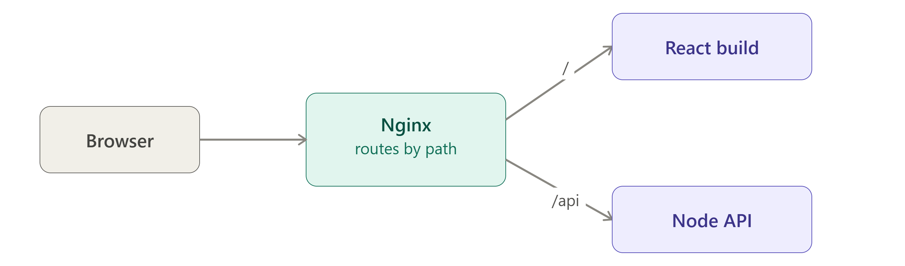

# Q: Walk me through deploying a MERN (Node.js + React) app with Nginx on a Linux server.

> **Level:** Intermediate · **Asked in:** DevOps, Full-stack, MERN developer, Cloud Engineer

## 🎯 Short answer (say this in the interview)

I create an Ubuntu VM, open only SSH, 80 and 443, and install Nginx, Node.js (via NodeSource or nvm) and PM2. The Express API runs under **PM2** on `127.0.0.1:5000`, with `pm2 startup` and `pm2 save` so it survives reboots, and its secrets come from environment variables, not Git. I build the React app (`npm run build`) and copy the static output to `/var/www/<app>`. One Nginx server block serves the React build with `try_files $uri /index.html` for client-side routing and proxies `/api/` to `127.0.0.1:5000` with the proper forwarding headers. Then I point the domain's DNS `A` record to the server, run certbot for HTTPS, and redeploys are: `git pull` → install → build → copy → `pm2 reload`. MongoDB is usually Atlas, or a local instance that is **never** exposed to the internet.

## 🧩 Scenario

You built a MERN e-commerce app: React frontend (Vite), Express API, MongoDB Atlas. It works on `localhost:5173` and `localhost:5000`. Your manager asks you to put it live at `https://shop.example.com` on a fresh Ubuntu cloud VM, make it survive reboots, and document how to redeploy.



## 💼 Use case

- Deploying side projects, startups' first production setup, internal tools.
- Any "frontend SPA + Node API" stack: MERN, MEVN, PERN, Next.js static export + Express.
- Same pattern works on AWS EC2, DigitalOcean, Azure VM, GCP Compute Engine, or bare metal.

## ⚙️ How it works

```text
                          Internet
                             |
              DNS: shop.example.com -> 203.0.113.10
                             |
                     +-------v--------+  ufw: only 22, 80, 443 open
                     |  Ubuntu VM     |
                     |                |
                     |  +----------+  |
  HTTPS :443  -------+->|  Nginx   |  |
  HTTP  :80 (301)    |  +----+-----+  |
                     |       |        |
                     |   /   |  /api/ |
           +---------+-------+        +--------------------+
           |                          |                    |
           v                          v                    |
  /var/www/shop/              127.0.0.1:5000               |
  index.html, assets/         Express API (PM2, 2 procs)   |
  (React build, static)              |                     |
                     |               v                     |
                     |        MongoDB Atlas (TLS)  or      |
                     |        local mongod on 127.0.0.1    |
                     +-------------------------------------+
```

- Browser loads React from Nginx (fast static serving, gzip, caching).
- React calls `/api/...` on the **same domain** → no CORS issues.
- Nginx proxies `/api/` to Express on localhost; Express is never exposed directly.

## 🛠️ Practical: step by step

### Step 1 — Provision the VM and secure SSH

Create an Ubuntu 22.04/24.04 VM (1–2 GB RAM is fine to start). In the cloud firewall/security group allow inbound **22, 80, 443** only.

```bash
ssh ubuntu@203.0.113.10

sudo apt update && sudo apt upgrade -y
sudo apt install -y git curl ufw

# Firewall: allow SSH first so you don't lock yourself out
sudo ufw allow OpenSSH
sudo ufw enable
```

Optional but recommended: create a non-root deploy user and use SSH keys only.

### Step 2 — Install Nginx

```bash
sudo apt install -y nginx
sudo ufw allow 'Nginx Full'          # ports 80 and 443
sudo systemctl enable --now nginx
curl -I http://localhost             # HTTP/1.1 200 OK (Ubuntu welcome page)
```

### Step 3 — Install Node.js (choose ONE)

**Option A — NodeSource (system-wide, works well with PM2 startup):**

```bash
curl -fsSL https://deb.nodesource.com/setup_lts.x -o nodesource_setup.sh
less nodesource_setup.sh                 # review before running
sudo -E bash nodesource_setup.sh
sudo apt install -y nodejs
node -v && npm -v
```

**Option B — nvm (per-user, easy to switch versions):**

```bash
# Get the install command for the latest nvm release from https://github.com/nvm-sh/nvm#installing-and-updating
# then reload your shell:
source ~/.bashrc
nvm install --lts
node -v && npm -v
```

### Step 4 — Get the code and run the API with PM2

```bash
sudo npm install -g pm2          # with nvm: just "npm install -g pm2" (no sudo)

sudo mkdir -p /opt/shop && sudo chown $USER:$USER /opt/shop
git clone https://github.com/<your-org>/<your-repo>.git /opt/shop
cd /opt/shop/server
npm ci --omit=dev
```

Create the environment file (never commit it):

```bash
nano /opt/shop/server/.env
chmod 600 /opt/shop/server/.env
```

```bash
# /opt/shop/server/.env
NODE_ENV=production
PORT=5000
HOST=127.0.0.1
MONGO_URI=mongodb+srv://<user>:<password>@<cluster>.mongodb.net/shop
JWT_SECRET=<long-random-string>
```

Make sure the Express app loads `.env` (e.g. `require('dotenv').config()`), listens on `127.0.0.1`, and trusts the proxy:

```js
// server/index.js (relevant lines)
require('dotenv').config();
const app = require('express')();
app.set('trust proxy', 1);                   // correct req.ip / req.protocol behind Nginx
app.get('/api/health', (req, res) => res.json({ ok: true }));
app.listen(process.env.PORT, process.env.HOST);
```

Create a PM2 ecosystem file so the start command is repeatable:

```js
// /opt/shop/server/ecosystem.config.js
module.exports = {
  apps: [{
    name: 'shop-api',
    script: 'index.js',
    cwd: '/opt/shop/server',
    instances: 2,              // or 'max' = one per CPU core
    exec_mode: 'cluster',      // lets "pm2 reload" restart with zero downtime
    env: { NODE_ENV: 'production' },
  }],
};
```

```bash
cd /opt/shop/server
pm2 start ecosystem.config.js      # or simply: pm2 start index.js --name shop-api
pm2 status
pm2 logs shop-api --lines 20

# Start PM2 on boot:
pm2 startup                        # prints a "sudo env PATH=... pm2 startup systemd -u ..." command
# -> copy and run the printed command exactly
pm2 save                           # save the current process list for resurrection on boot

curl http://127.0.0.1:5000/api/health   # {"ok":true}
```

### Step 5 — Build React and copy it to /var/www

```bash
cd /opt/shop/client
npm ci
# API base URL should be relative ("/api") so it works on any domain.
# For Vite, build-time variables must start with VITE_, e.g. VITE_API_URL=/api
npm run build                      # Vite -> dist/   (Create React App -> build/)

sudo mkdir -p /var/www/shop
sudo rsync -a --delete dist/ /var/www/shop/
sudo chown -R www-data:www-data /var/www/shop
```

### Step 6 — Nginx server block

```bash
sudo nano /etc/nginx/sites-available/shop.example.com
```

```nginx
# File: /etc/nginx/sites-available/shop.example.com
server {
    listen 80;
    listen [::]:80;
    server_name shop.example.com www.shop.example.com;

    root /var/www/shop;
    index index.html;

    access_log /var/log/nginx/shop.access.log;
    error_log  /var/log/nginx/shop.error.log;

    client_max_body_size 10m;          # allow image uploads up to 10 MB (default 1m)

    # --- API: proxy to Express on localhost ---
    # No trailing slash on proxy_pass -> the /api prefix is kept:
    # /api/products -> http://127.0.0.1:5000/api/products
    location /api/ {
        proxy_pass http://127.0.0.1:5000;
        proxy_http_version 1.1;
        proxy_set_header Host              $host;
        proxy_set_header X-Real-IP         $remote_addr;
        proxy_set_header X-Forwarded-For   $proxy_add_x_forwarded_for;
        proxy_set_header X-Forwarded-Proto $scheme;
        proxy_read_timeout 60s;
    }

    # --- Hashed static assets: cache for a year ---
    location /assets/ {
        try_files $uri =404;
        add_header Cache-Control "public, max-age=31536000, immutable" always;
        access_log off;
    }

    # --- index.html: always revalidate (new deploys show up immediately) ---
    location = /index.html {
        add_header Cache-Control "no-cache" always;
    }

    # --- React Router: unknown paths -> index.html ---
    location / {
        try_files $uri $uri/ /index.html;
    }
}
```

```bash
sudo ln -s /etc/nginx/sites-available/shop.example.com /etc/nginx/sites-enabled/
sudo rm -f /etc/nginx/sites-enabled/default      # remove Ubuntu's welcome site
sudo nginx -t && sudo systemctl reload nginx
```

### Step 7 — DNS

At your DNS provider:

| Type | Name | Value |
|---|---|---|
| A | `shop` | `203.0.113.10` |
| A (or CNAME → `shop.example.com`) | `www.shop` | `203.0.113.10` |

```bash
dig +short shop.example.com      # must return 203.0.113.10 before running certbot
```

### Step 8 — HTTPS with certbot

```bash
sudo snap install --classic certbot
sudo ln -s /snap/bin/certbot /usr/bin/certbot
sudo certbot --nginx -d shop.example.com -d www.shop.example.com
sudo certbot renew --dry-run
```

Certbot adds the `listen 443 ssl` block, certificate paths, and the HTTP→HTTPS redirect.

### Step 9 — Redeploy (every new release)

```bash
cd /opt/shop
git pull origin main

# Backend
cd server
npm ci --omit=dev
pm2 reload shop-api            # zero-downtime in cluster mode (use "restart" in fork mode)

# Frontend
cd ../client
npm ci
npm run build
sudo rsync -a --delete dist/ /var/www/shop/
# No Nginx reload needed for new static files.
# Reload Nginx only when its config changes: sudo nginx -t && sudo systemctl reload nginx
```

Put these lines in a `deploy.sh` script, and later move them into a CI/CD pipeline (GitHub Actions over SSH, etc.).

### If MongoDB runs on the same VM

- Keep `bindIp: 127.0.0.1` in `/etc/mongod.conf`, enable authentication, and **do not** open port 27017 in ufw or the cloud firewall.

## 📁 Files involved

| File / Folder | What it does here |
|---|---|
| `/etc/nginx/sites-available/shop.example.com` | Serves React build, proxies `/api/` to Express |
| `/etc/nginx/sites-enabled/shop.example.com` | Symlink that activates the site |
| `/var/www/shop/` | React production build (`index.html`, `assets/`) |
| `/opt/shop/server/` | Express API source code |
| `/opt/shop/server/.env` | Secrets and config (chmod 600, not in Git) |
| `/opt/shop/server/ecosystem.config.js` | PM2 app definition |
| `~/.pm2/dump.pm2` | Process list saved by `pm2 save` |
| `/etc/systemd/system/pm2-<user>.service` | Created by `pm2 startup` to launch PM2 on boot |
| `/etc/letsencrypt/live/shop.example.com/` | TLS certificate and key |
| `/var/log/nginx/shop.*.log` | Nginx logs for this site |
| `~/.pm2/logs/` | API stdout/stderr logs |

## ✅ Verify it works

```bash
sudo nginx -t
sudo systemctl reload nginx

pm2 status                                       # shop-api: online
curl -s http://127.0.0.1:5000/api/health         # {"ok":true}  (direct to Express)

curl -I http://shop.example.com/
# HTTP/1.1 301 Moved Permanently
# Location: https://shop.example.com/

curl -I https://shop.example.com/
# HTTP/2 200 (or HTTP/1.1 200)
# content-type: text/html

curl -s https://shop.example.com/api/health      # {"ok":true}  (through Nginx)

curl -s -o /dev/null -w '%{http_code}\n' https://shop.example.com/products/42
# 200   (React Router deep link works on refresh)

# Port 5000 must NOT be reachable from outside (run from your laptop):
curl -m 5 http://203.0.113.10:5000/api/health   # should time out / be refused

# Survives reboot?
sudo reboot
# ...reconnect, then:
pm2 status && curl -s https://shop.example.com/api/health
```

## ⚠️ Common mistakes

- Express listening on `0.0.0.0:5000` and port 5000 open → API reachable without Nginx/TLS. Bind to `127.0.0.1`.
- Hardcoding `http://localhost:5000` as the API URL in React → works on your laptop, fails for users. Use relative `/api`.
- `proxy_pass http://127.0.0.1:5000/;` (with trailing slash) when the Express routes are under `/api` → the `/api/` prefix gets stripped and routes 404.
- Forgetting `try_files ... /index.html` → 404 on page refresh.
- Running `pm2 startup` but not executing the printed command, or forgetting `pm2 save` → API is gone after reboot.
- Using `pm2` installed with nvm under one user and running `pm2 startup` as another → PATH issues. Use the exact command PM2 prints.
- Committing `.env` to Git, or passing secrets on the command line (visible in `ps`).
- `502 Bad Gateway` → the API is down or on a different port. Check `pm2 logs` and `/var/log/nginx/shop.error.log` (`connect() failed (111: Connection refused)`).
- `413 Request Entity Too Large` on uploads → raise `client_max_body_size`.
- Opening MongoDB's 27017 to the internet.

## 🔁 Follow-up questions interviewers ask

- **Why not run Express on port 80 directly?** Ports below 1024 need root; Nginx also gives TLS, gzip, caching, static file speed, buffering against slow clients, and lets you host multiple apps.
- **Why PM2 (or systemd)?** It restarts the app on crash, starts it on boot, runs multiple instances in cluster mode, and manages logs. A plain `node index.js` dies with your SSH session.
- **`pm2 restart` vs `pm2 reload`?** `restart` kills and starts processes (brief downtime); `reload` restarts cluster-mode instances one by one for zero downtime.
- **How would you make this more production-grade?** CI/CD pipeline, Docker images, a managed DB, separate staging, monitoring (PM2 metrics / Prometheus), log shipping, backups, and multiple app servers behind a load balancer.
- **Where do you serve the React build from in a bigger setup?** Often an S3 bucket + CDN (CloudFront) for the frontend, with Nginx/ALB only for the API.

---
[⬅️ Previous](09-gzip-compression-and-browser-caching.md) · [🏠 Index](../README.md) · [Next ➡️](11-access-and-error-logs.md)
