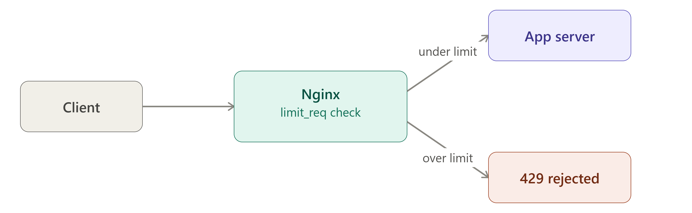

# Q: How do you implement rate limiting in Nginx? Explain `burst`, `nodelay` and how you'd protect a login endpoint.

> **Level:** Advanced · **Asked in:** DevOps, SRE, Security Engineer, Platform Engineer

## 🎯 Short answer (say this in the interview)

Nginx open source has two modules: `limit_req` limits the **request rate** per key, and `limit_conn` limits the number of **concurrent connections** per key. I define a shared-memory zone in the `http` block with `limit_req_zone $binary_remote_addr zone=login:10m rate=5r/m;` and apply it in a `location` with `limit_req zone=login burst=5 nodelay;`. It uses the leaky-bucket algorithm: `rate` is the steady rate, `burst` is how many extra requests can queue, and `nodelay` serves the burst immediately instead of spacing them out. Requests over the limit get `503` by default, so I set `limit_req_status 429;`, and I whitelist internal IPs using `geo` plus `map` so their key is empty.

## 🧩 Scenario

Your security team sees a bot trying thousands of passwords per minute against `POST /login`. At the same time, the public API `/api/` is being scraped by a single IP that hammers it with hundreds of requests per second, slowing it down for everyone else. Office and monitoring IPs must never be limited. You need to stop the abuse at the Nginx layer, before it reaches the app.

## 💼 Use case

- Brute-force protection on `/login`, `/wp-login.php`, `/otp`, `/password-reset`.
- Fair-use limits on public APIs per client IP (or per API key).
- Limiting concurrent downloads per IP with `limit_conn`.
- Protecting a fragile backend from traffic spikes.

## ⚙️ How it works



```text
 requests from 1 IP ──►  ┌───────────────────────────┐
                         │ bucket for key = client IP│
                         │                           │
                         │  burst queue (size=N)     │──► leaks to backend at `rate`
                         │  [req][req][req][ ][ ]    │     e.g. 10r/s = 1 every 100ms
                         └─────────────┬─────────────┘
                                       │ queue full?
                                       ▼
                              rejected → limit_req_status (429)

 without nodelay : queued requests are DELAYED so they leave at `rate`
 with nodelay    : queued requests are sent IMMEDIATELY, but the burst slots
                   only free up again at `rate`
 with delay=K    : first K extra requests go immediately, the rest are delayed
```

**Key pieces**

| Directive | Context | Meaning |
|---|---|---|
| `limit_req_zone $binary_remote_addr zone=api:10m rate=10r/s;` | `http` | Shared memory zone named `api`, 10 MB, key = client IP in binary form, 10 requests/second |
| `limit_req zone=api burst=20 nodelay;` | `http`, `server`, `location` | Apply the zone; allow a burst of 20 extra requests |
| `limit_req_status 429;` | `http`, `server`, `location` | Status for rejected requests (default `503`) |
| `limit_req_log_level warn;` | `http`, `server`, `location` | Log level for rejections (default `error`) |
| `limit_conn_zone $binary_remote_addr zone=perip:10m;` | `http` | Zone for counting concurrent connections |
| `limit_conn perip 10;` | `http`, `server`, `location` | Max 10 concurrent connections per IP |

Why `$binary_remote_addr` and not `$remote_addr`? It is a fixed 4 bytes (IPv4) / 16 bytes (IPv6) instead of a text string up to 39 characters, so more IPs fit in the zone. The Nginx docs say a 1 MB zone holds about 16,000 states (64-byte states), so `10m` holds roughly 160,000 IPs. When the zone is full, Nginx evicts old entries, and if it still cannot create a new one it rejects the request.

Rates can be `r/s` or `r/m`. `rate=5r/m` means one request every 12 seconds on average.

## 🛠️ Practical: step by step

1. **Create the zones** — file: `/etc/nginx/conf.d/rate-limit.conf` (files in `conf.d` are included inside the `http` block on Ubuntu)

```nginx
# /etc/nginx/conf.d/rate-limit.conf   (http context)

# 1) Mark trusted IPs. geo sets $limit to 0 for trusted, 1 for everyone else.
geo $limit {
    default        1;
    127.0.0.1      0;     # localhost / health checks
    10.0.0.0/8     0;     # internal network
    203.0.113.10   0;     # office IP (example)
}

# 2) Turn that into the zone key. An EMPTY key is NOT counted → trusted IPs are never limited.
map $limit $limit_key {
    0  "";
    1  $binary_remote_addr;
}

# 3) Zones
limit_req_zone  $limit_key zone=api:10m   rate=10r/s;   # public API
limit_req_zone  $limit_key zone=login:10m rate=5r/m;    # login: 5 per minute per IP
limit_conn_zone $limit_key zone=perip:10m;              # concurrent connections

# 4) Behaviour for rejected requests
limit_req_status  429;
limit_conn_status 429;
limit_req_log_level warn;
```

2. **Apply the limits** — file: `/etc/nginx/sites-available/app.conf`

```nginx
upstream app_backend {
    server 127.0.0.1:3000;
}

server {
    listen 80;
    server_name app.example.com;

    # Max 20 concurrent connections per client IP for the whole site
    limit_conn perip 20;

    # Public API: 10 r/s steady, bursts of up to 20 served immediately
    location /api/ {
        limit_req zone=api burst=20 nodelay;
        proxy_pass http://app_backend;
        proxy_set_header Host $host;
        proxy_set_header X-Real-IP $remote_addr;
    }

    # Login: 5 r/m, allow a small burst of 3 typos, reject the rest
    location = /login {
        limit_req zone=login burst=3 nodelay;
        proxy_pass http://app_backend;
        proxy_set_header Host $host;
        proxy_set_header X-Real-IP $remote_addr;
    }

    # Example of two-stage limiting: first 8 extra requests fast, next 12 delayed
    location /search {
        limit_req zone=api burst=20 delay=8;
        proxy_pass http://app_backend;
    }

    location / {
        proxy_pass http://app_backend;
        proxy_set_header Host $host;
    }
}
```

3. **Enable and reload**

```bash
sudo ln -s /etc/nginx/sites-available/app.conf /etc/nginx/sites-enabled/
sudo nginx -t && sudo systemctl reload nginx
```

4. **(If you are behind a load balancer/CDN) Use the real client IP**, otherwise every request has the LB's IP and you rate-limit everyone together. Add to `/etc/nginx/conf.d/real-ip.conf`:

```nginx
# Trust X-Forwarded-For only from your load balancer's subnet
set_real_ip_from 10.0.0.0/16;
real_ip_header   X-Forwarded-For;
real_ip_recursive on;
```

5. **(Optional) Try it in dry-run mode first** (Nginx 1.17.1+, which includes Ubuntu 22.04's 1.18 and 24.04's 1.24): requests are counted and logged but not rejected.

```nginx
location /api/ {
    limit_req zone=api burst=20 nodelay;
    limit_req_dry_run on;
    proxy_pass http://app_backend;
}
```

## 📁 Files involved

| File / Folder | What it does here |
|---|---|
| `/etc/nginx/conf.d/rate-limit.conf` | `geo`, `map`, `limit_req_zone`, `limit_conn_zone` (http context) |
| `/etc/nginx/conf.d/real-ip.conf` | Restores the real client IP behind a load balancer |
| `/etc/nginx/sites-available/app.conf` | Applies `limit_req` / `limit_conn` to locations |
| `/var/log/nginx/error.log` | `limiting requests` / `limiting connections` messages |
| `/var/log/nginx/access.log` | Rejected requests appear with status `429` |

## ✅ Verify it works

Send 15 login attempts quickly (run this from a machine that is **not** whitelisted):

```bash
for i in $(seq 1 15); do
  curl -s -o /dev/null -w "%{http_code}\n" -X POST http://app.example.com/login
done | sort | uniq -c
```

Example output (1 allowed by the rate + 3 burst, the rest rejected; the backend's own status may differ from 200):

```text
      4 200
     11 429
```

API burst test:

```bash
for i in $(seq 1 50); do
  curl -s -o /dev/null -w "%{http_code}\n" http://app.example.com/api/health &
done; wait
```

Check the logs:

```bash
sudo grep "limiting requests" /var/log/nginx/error.log | tail -n 3
```

Example log line:

```text
[warn] 3012#3012: *41 limiting requests, excess: 3.990 by zone "login", client: 198.51.100.7, server: app.example.com, request: "POST /login HTTP/1.1", host: "app.example.com"
```

## ⚠️ Common mistakes

- Putting `limit_req_zone` inside a `server` or `location` block — it is only valid in `http`.
- Using `burst` without `nodelay` and wondering why pages feel slow: excess requests are being **delayed**, not rejected.
- Forgetting `limit_req_status 429;` — clients then get `503`, which looks like an outage in monitoring.
- Rate limiting behind a load balancer without `real_ip` — all users share one IP and get blocked together.
- Rate limiting static assets on the same zone as the API; one page load with 40 images can trip the limit.
- Whitelisting with `if` blocks instead of the `geo`/`map` empty-key pattern.
- Setting the zone too small for the number of unique clients.

## 🔁 Follow-up questions interviewers ask

1. **What is the difference between `limit_req` and `limit_conn`?**
   `limit_req` limits how many requests per second/minute; `limit_conn` limits how many connections are open at the same time.
2. **Can you rate-limit by something other than IP?**
   Yes, any variable can be the key, e.g. `$http_x_api_key` or a cookie. Make sure the key cannot be trivially changed by the attacker.
3. **Are limits shared across workers?**
   Yes, the state is stored in shared memory (the zone), so all workers on that server see the same counts. It is **not** shared across multiple Nginx servers.
4. **Can you apply multiple limits to one location?**
   Yes, use several `limit_req` lines; the most restrictive one wins.
5. **Is rate limiting enough to stop a DDoS?**
   No. It helps against single-source abuse; large distributed attacks need upstream protection (CDN/WAF/cloud DDoS service).

---
[⬅️ Previous](03-zero-downtime-reload-and-signals.md) · [🏠 Index](../README.md) · [Next ➡️](05-websocket-proxy.md)
