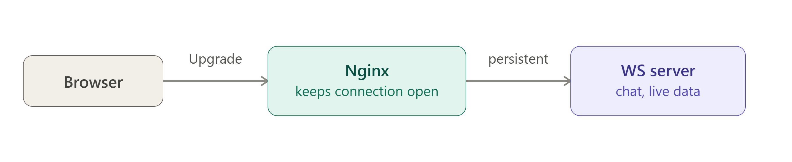

# Q: How do you proxy WebSocket connections through Nginx?

> **Level:** Advanced · **Asked in:** DevOps, SRE, Full-stack, Platform Engineer

## 🎯 Short answer (say this in the interview)

A WebSocket starts as a normal HTTP/1.1 request with `Upgrade: websocket` and `Connection: Upgrade` headers, and the server answers `101 Switching Protocols`. These are **hop-by-hop** headers, so Nginx does not pass them to the backend by default. In the proxied location I set `proxy_http_version 1.1;`, `proxy_set_header Upgrade $http_upgrade;` and `proxy_set_header Connection $connection_upgrade;`, where `$connection_upgrade` comes from a `map` in the `http` block. Because WebSockets are long-lived and may be idle, I raise `proxy_read_timeout` (default 60s) or rely on app-level ping/pong. With multiple backends, Socket.IO needs sticky sessions, so I use `ip_hash` (or `hash`) in the upstream.

## 🧩 Scenario

Your team ships a real-time chat app built with Node.js and Socket.IO. It works on a developer laptop, but in production behind Nginx the browser console shows `WebSocket connection to 'wss://chat.example.com/socket.io/...' failed`, and connections that do work drop after exactly one minute of inactivity. Later you scale to two Node.js instances and users start getting random disconnects. You need to fix all three problems.

## 💼 Use case

- Chat apps, live notifications, collaborative editors.
- Live dashboards, trading tickers, sports scores.
- Dev tools like hot-reload servers behind a proxy.
- Any Socket.IO, `ws`, SignalR, or GraphQL subscriptions backend behind Nginx.

## ⚙️ How it works



```text
 Browser                         Nginx                          Node.js (ws / Socket.IO)
   │  GET /socket.io/?EIO=4&transport=websocket HTTP/1.1          │
   │  Upgrade: websocket                                           │
   │  Connection: Upgrade                                          │
   │ ───────────────────────────►│                                 │
   │                             │  proxy_http_version 1.1         │
   │                             │  Upgrade: websocket   (re-added)│
   │                             │  Connection: upgrade  (re-added)│
   │                             │ ───────────────────────────────►│
   │                             │◄──── 101 Switching Protocols ───│
   │◄──── 101 Switching Protocols│                                 │
   │                             │                                 │
   │◄═══════ two-way frames ════►│◄═══════ two-way frames ════════►│
   │    (one long-lived TCP connection on each side;               │
   │     closed if idle > proxy_read_timeout)                      │
```

**Why the `map`?**

```nginx
map $http_upgrade $connection_upgrade {
    default upgrade;   # client sent an Upgrade header  → "Connection: upgrade"
    ''      close;     # normal HTTP request (no Upgrade) → "Connection: close"
}
```

This lets the same location handle both normal HTTP requests (like Socket.IO's long-polling fallback) and WebSocket upgrades correctly.

**Why sticky sessions for Socket.IO?**
Socket.IO first does an HTTP handshake (polling) and then upgrades. All requests for one session must hit the **same** backend, otherwise the second backend says "unknown session ID". `ip_hash` sends the same client IP to the same server.

## 🛠️ Practical: step by step

1. **Create a tiny Socket.IO backend** (on the Nginx server, for testing)

```bash
sudo apt install -y nodejs npm
mkdir -p ~/chat && cd ~/chat
npm init -y
npm install socket.io
cat > server.js <<'EOF'
const { Server } = require("socket.io");
const port = process.env.PORT || 3000;
const io = new Server(port, { cors: { origin: "*" } });
io.on("connection", (socket) => {
  socket.emit("hello", `connected to backend on port ${port}`);
  socket.on("chat", (msg) => io.emit("chat", msg));
});
console.log(`socket.io listening on ${port}`);
EOF
PORT=3000 node server.js &
PORT=3001 node server.js &
```

2. **Add the `map`** — file: `/etc/nginx/conf.d/websocket-map.conf` (http context)

```nginx
# /etc/nginx/conf.d/websocket-map.conf
map $http_upgrade $connection_upgrade {
    default upgrade;
    ''      close;
}
```

3. **Create the site** — file: `/etc/nginx/sites-available/chat.conf`

```nginx
upstream chat_backend {
    ip_hash;                       # sticky: same client IP → same backend (needed by Socket.IO)
    server 127.0.0.1:3000;
    server 127.0.0.1:3001;
}

server {
    listen 80;
    server_name chat.example.com;

    # Socket.IO uses /socket.io/ by default
    location /socket.io/ {
        proxy_pass http://chat_backend;

        proxy_http_version 1.1;                          # WebSocket needs HTTP/1.1
        proxy_set_header Upgrade    $http_upgrade;       # pass the Upgrade header
        proxy_set_header Connection $connection_upgrade; # "upgrade" or "close"

        proxy_set_header Host              $host;
        proxy_set_header X-Real-IP         $remote_addr;
        proxy_set_header X-Forwarded-For   $proxy_add_x_forwarded_for;
        proxy_set_header X-Forwarded-Proto $scheme;

        # Keep idle sockets open longer than the default 60s
        proxy_read_timeout 3600s;
        proxy_send_timeout 3600s;

        proxy_buffering off;         # push frames/events immediately
    }

    # A plain ws endpoint (e.g. the "ws" npm library) works the same way
    location /ws/ {
        proxy_pass http://chat_backend;
        proxy_http_version 1.1;
        proxy_set_header Upgrade    $http_upgrade;
        proxy_set_header Connection $connection_upgrade;
        proxy_set_header Host       $host;
        proxy_read_timeout 3600s;
    }
}
```

4. **Enable and reload**

```bash
sudo ln -s /etc/nginx/sites-available/chat.conf /etc/nginx/sites-enabled/
sudo nginx -t && sudo systemctl reload nginx
```

5. **For HTTPS (wss://)** nothing WebSocket-specific changes: terminate TLS in the `server` block (`listen 443 ssl;` + certificates) and keep the same location. The browser connects to `wss://`, Nginx talks plain `ws://` (HTTP) to the backend.

> Behind an `ip_hash` upstream, if a cloud load balancer sits in front of Nginx, every client may look like the LB's IP. Restore the real IP with the `realip` module, or hash on something client-specific such as your app's session cookie (for example `hash $cookie_sessionid consistent;`).

## 📁 Files involved

| File / Folder | What it does here |
|---|---|
| `/etc/nginx/conf.d/websocket-map.conf` | `map $http_upgrade $connection_upgrade` (http context) |
| `/etc/nginx/sites-available/chat.conf` | Upstream with `ip_hash` and the WebSocket locations |
| `/etc/nginx/sites-enabled/chat.conf` | Symlink that activates the site |
| `~/chat/server.js` | Test Socket.IO backend |
| `/var/log/nginx/access.log` | Upgrade requests are logged with status `101` |

## ✅ Verify it works

1. **Check the raw handshake with curl** (`-i` shows headers; `--max-time` stops it because the socket stays open):

```bash
curl -i --max-time 3 -H "Host: chat.example.com" \
  -H "Connection: Upgrade" -H "Upgrade: websocket" \
  -H "Sec-WebSocket-Version: 13" -H "Sec-WebSocket-Key: dGhlIHNhbXBsZSBub25jZQ==" \
  "http://127.0.0.1/socket.io/?EIO=4&transport=websocket"
```

Expected (first lines):

```text
HTTP/1.1 101 Switching Protocols
Upgrade: websocket
Connection: upgrade
```

2. **Interactive test with `wscat`**

```bash
sudo npm install -g wscat
wscat -H "Host: chat.example.com" -c "ws://127.0.0.1/socket.io/?EIO=4&transport=websocket"
```

Example output (Engine.IO protocol frames; `0{...}` is the open packet):

```text
Connected (press CTRL+C to quit)
< 0{"sid":"...","upgrades":[],"pingInterval":25000,"pingTimeout":20000,"maxPayload":1000000}
```

Type `40` and press Enter to join the default Socket.IO namespace; you should get `40{"sid":"..."}` and then the `hello` event.

3. **Check the access log**

```bash
sudo tail -n 3 /var/log/nginx/access.log
```

You should see the `/socket.io/` request with status `101`.

## ⚠️ Common mistakes

- Missing `proxy_http_version 1.1;` — Nginx talks HTTP/1.0 to upstreams by default, which has no Upgrade mechanism.
- Hard-coding `proxy_set_header Connection "upgrade";` on a location that also serves normal HTTP; use the `map`.
- Putting the `map` inside a `server` or `location` block — `map` is only valid in `http`.
- Leaving `proxy_read_timeout` at 60s; idle sockets get closed after a minute (a classic "disconnects every 60 seconds" bug).
- Scaling Socket.IO to multiple backends without sticky sessions (and without a shared adapter like Redis for broadcasting).
- Using `ip_hash` behind a load balancer without restoring the real client IP — everyone lands on one backend.

## 🔁 Follow-up questions interviewers ask

1. **Why are `Upgrade` and `Connection` not forwarded automatically?**
   They are hop-by-hop headers: they apply to one connection only, so proxies must explicitly re-send them.
2. **What status code means the upgrade succeeded?**
   `101 Switching Protocols`.
3. **How do you stop idle WebSocket disconnects without huge timeouts?**
   Have the app send ping/pong frames more often than `proxy_read_timeout` (Socket.IO does this by default with `pingInterval`).
4. **What happens to open WebSockets on `nginx -s reload`?**
   The old worker keeps them open until they close; use `worker_shutdown_timeout` to cap that, and make clients reconnect automatically.
5. **Is `ip_hash` the only sticky option?**
   In open source you can also use `hash <key> consistent;`. Cookie-based `sticky` is an Nginx Plus feature.

---
[⬅️ Previous](04-rate-limiting.md) · [🏠 Index](../README.md) · [Next ➡️](06-proxy-caching.md)
